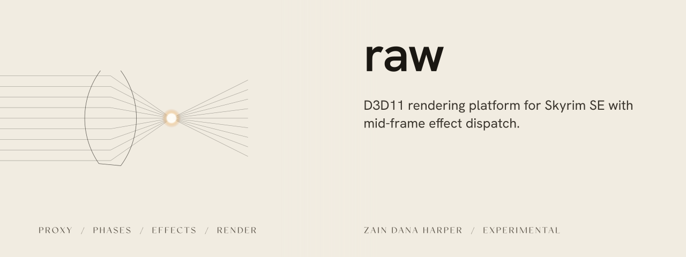

<picture>
  <source media="(prefers-color-scheme: dark)" srcset="https://raw.githubusercontent.com/HarperZ9/raw/master/docs/art/hero-dark.svg">
  
</picture>

# RAW

DirectX 12 translation layer (`d3d11.dll`) and Creation Engine runtime (`raw_engine.dll`) for **The Elder Scrolls V: Skyrim Special Edition**.

[](https://github.com/HarperZ9/raw/blob/master/LICENSE)


Part of THE PLAYGROUND ([harperz9.github.io/playground/](https://harperz9.github.io/playground/)). RAW translates Skyrim's D3D11 calls into a DirectX 12 render graph (`raw::tx` + `d3d12_bridge`) and pairs it with runtime engine hooks (`raw_engine.dll`). Every shader compiles for Shader Model 6.6 with 16-bit FP16 ops so it runs on standard Windows 10 and 11 D3D12 with zero bundled third-party DLLs.

> Not affiliated with or endorsed by Bethesda Softworks, NVIDIA, or ENBSeries; requires a legally owned copy of Skyrim Special Edition, and source code is provided under the MIT license.

## Supported Game Versions and Setups

- **`d3d11.dll`:** Runs on any 64-bit Skyrim Special Edition, Anniversary Edition, or GOG executable. Opaque G-Buffer detection supports 2-, 3-, and 4-target setups (TAA on or off, Improved Snow on or off, SAO on or off).
- **`raw_engine.dll`:** Uses verified static address tables for `1.6.1170.0` and `1.7.104.0`, and falls back to a built-in runtime MSVC RTTI and `Setting` scanner on all other Skyrim SE, AE, and GOG builds (`1.5.97`, `1.6.353`, `1.6.640`, `1.6.659 GOG`, `1.6.1130`, `1.6.1179 GOG`, and future patches) to resolve shader/engine vtables and INI/Prefs/GMST settings automatically.

## Quick Install

1. Disable or remove conflicting graphics wrappers: **ENBSeries** (`d3d11.dll`, `d3dcompiler_46e.dll`), **Community Shaders**, **DXVK**, and **D3D11 ReShade**.
2. Extract the release archive into your Skyrim Special Edition root folder (next to `SkyrimSE.exe`), or deploy through MO2 Root Builder or Vortex Root Deploy.
3. Launch `SkyrimSE.exe` (or `skse64_loader.exe`). Press `End` to open the HUD, check the `STATUS` line at the top to confirm `DX12 BRIDGE ACTIVE`, and press `F10` to cycle Vanilla (`0`), Match (`1`), and RAW DX12 (`2`).

### In-Game Controls

| Key | Action |
|---|---|
| `End` | Open or close RAW DX12 Studio HUD |
| `Tab` / `PgUp` / `PgDn` | Switch tabs (`1:RT`, `2:Sky/Fog`, `3:Weather`, `4:Water`, `5:Skin/AO`, `6:Tonemap`, `7:LUTs/OV`, `8:Camera/DoF`) |
| Arrow Keys | Adjust selected parameter live (hold `Shift` for fine steps) |
| `S` / `L` | Save settings or load active preset slot |
| `P` | Export camera settings to `raw_captures` |
| `F10` | Cycle lighting mode (`0` Vanilla, `1` Match, `2` RAW DX12) |

## What Uses DX12 and DXR vs Regular Shader Math

- **DX12 and DXR pipeline work:** D3D11-to-D3D12 translation (`raw::tx`), per-frame BLAS and TLAS builds from intercepted geometry and skinned actors, inline `RayQuery` hardware ray-traced sun shadows, area point-light shadows, RTAO, multi-bounce indirect diffuse, and glossy reflections. On supported GPUs, the bridge also initializes SM 6.6 mesh shader subdivision (`RAW-MESH`), a 65K bindless descriptor heap, async compute, and `ExecuteIndirect` batching.
- **Deferred lighting and world passes on top of that pipeline:** GGX and 4-slab layered BRDF shading, TruePBR (`_rmaos.dds`) and ENB Complex Material (`_m.dds`) texture reads, 36-step 3D Perlin-Worley volumetric clouds, `160x90x64` froxel fog, depth-free Gerstner wave parallax water with Beer-Lambert absorption, procedural weather, a 5-pass DoF camera suite, LUT support from `raw_luts/`, and RAWLSS 5.5 temporal reconstruction (an open SM 6.6 FP16 pass, separate from NVIDIA DLSS 5).

## Building From Source

Requires Visual Studio 2022 or 2026 (C++23), CMake 3.25+, Ninja, and DirectX Shader Compiler (`dxc`).

```powershell
cmake -B build -S . -G Ninja -DCMAKE_BUILD_TYPE=Release
cmake --build build --target raw_engine d3d11_proxy
```

## Known Limits

- **Depth format:** `TxDepth32` stays disabled (`TxDepth32=0`) because Skyrim SE's compiled 24-bit DXBC depth shaders mismatch 32-bit float depth promotion.
- **Mod conflicts:** ENBSeries, Community Shaders, and D3D11 ReShade intercept the same `d3d11.dll` and G-Buffer entry points and must be disabled when running RAW.
- **Runtime scan scope on non-table versions:** On versions without a static `.tsv` table (such as GOG `1.6.1179.0` or `1.5.97`), the runtime RTTI and `Setting` scanner resolves vtables, vtable slot hooks, and INI/Prefs/GMST settings automatically, while non-RTTI engine singletons stay cleanly disabled until mapped.
- **Fallout 4 port:** Architecture is designed for reuse, though only Skyrim SE is built and tested today.
