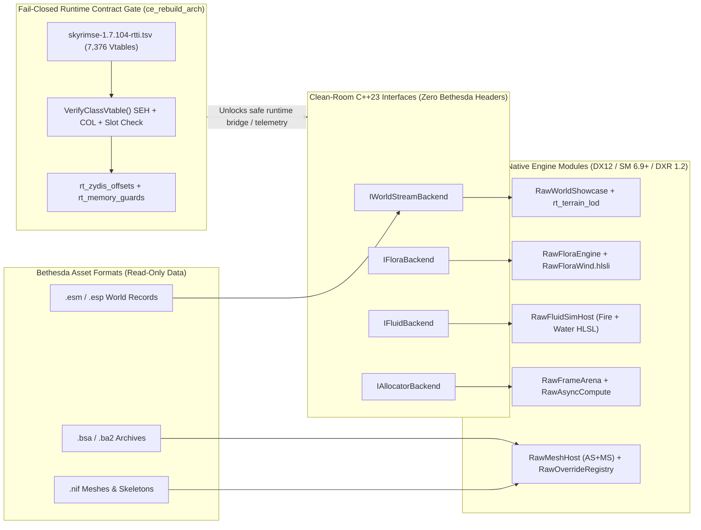

# Creation Engine 1.7.104 First-Principles Clean-Room Rebuild Architecture

> **Binary Provenance:** Every class name, vtable RVA, `RTTICompleteObjectLocator` RVA, virtual method RVA, and inheritance chain in this document and in [`data/versions/skyrimse-1.7.104-rtti.tsv`](../data/versions/skyrimse-1.7.104-rtti.tsv) was extracted directly from `SkyrimSE.exe 1.7.104.0` (`37,910,440` bytes, `TimeDateStamp=0x6A8C7046`, `ImageBase=0x140000000`, `SizeOfImage=0x3929000`, `122,258` `.pdata` functions) via [`tools/ce_decompiler.py`](../tools/ce_decompiler.py). Zero addresses are estimated or carried blindly from older builds.

---

## 1. Executive Summary & Extraction Telemetry

RAW's strategic goal is not merely to wrap Creation Engine's 2011 D3D11 draw calls, but to systematically **decouple Skyrim's `.esm`/`.esp`/`.bsa`/`.nif` world data from Bethesda's 2011 runtime engine** and replace every legacy subsystem with clean-room, MIT-licensed C++23 / DX12 / SM 6.9+ native systems.

Running `tools/ce_decompiler.py` against `SkyrimSE.exe 1.7.104.0` completes full MSVC x64 RTTI recovery in **~450 ms** and extracts:

| Metric | Verified Value (`SkyrimSE.exe 1.7.104.0`) |
|---|---|
| PE64 Binary Size | `37,910,440` bytes |
| PE Timestamp / Image Size | `0x6A8C7046` / `0x03929000` (`ImageBase = 0x140000000`) |
| `.pdata` `RUNTIME_FUNCTION` Entries | `122,258` |
| Self-Consistent `RTTICompleteObjectLocator` (`sig == 1 && pSelf == col_rva`) | `8,623` |
| Primary Polymorphic Class Vtables (`col.offset == 0`, emitted to TSV) | **`7,376`** |
| Multiple-Inheritance Secondary Vtables (`col.offset > 0`) | `1,247` |
| Automated Verifier (`ce_rebuild_arch.cpp`) Canonical Contracts | `28` core contracts across all 10 replacement subsystems |

### Subsystem Class Distribution (`data/versions/skyrimse-1.7.104-rtti.tsv`)

| Subsystem Taxonomy | Primary RTTI Classes | RAW Replacement Target (`ce_rebuild_arch.h`) |
|---|---:|---|
| `CameraActors` | `2,921` | `rt_view`, `rt_combat_ai`, `rt_skeleton_ik`, `CeNavMesh` |
| `CoreEngine` (forms, quests, misc) | `1,677` | `CeFormatReader` (`.esm`/`.esp` record parser) |
| `PhysicsWorld` (Havok / `bhk*`) | `865` | `PhysicsWorld` (`rt_softbody`, `rt_skeleton_ik`, `CeNavMesh`) |
| `SkyAtmosphere` | `404` | `RenderPipeline` (Hillaire SkyView + Nubis Evolved clouds + `rt_weather`) |
| `ScriptingUI` (Papyrus / Scaleform) | `314` | `rt_papyrus`, `RawStudioUi`, `RawInputEngine` |
| `RenderPipeline` | `259` | `RenderPipeline` (`raw::tx`, `D3D12Bridge`, `RawMeshHost`, DXR 1.2) |
| `MagicFX` | `208` | `FluidCombustion` (`RawSpells3D.hlsli`, `RawDecals3D.hlsli`, `BGSDecalManager`) |
| `MemoryAllocator` | `201` | `MemoryAllocator` (`rt_memory_guards`, `IAllocatorBackend` / `RawFrameArena`) |
| `AssetArchive` | `199` | `AssetArchive` (`CeFormatReader`, `CeNifReader`, `RawOverrideRegistry`, `RawAssetBridge`) |
| `JobScheduler` | `80` | `JobScheduler` (`RawAsyncCompute`, `RawAssetStream`) |
| `WorldStreaming` | `69` | `WorldStreaming` (`RawWorldShowcase`, `rt_grids`, `rt_memory_guards`) |
| `FluidCombustion` | `61` | `FluidCombustion` (`RawFluidSimHost`, `RawFluidFireSim.hlsl`) |
| `WaterSim` | `46` | `WaterSim` (`RtWater`, `BridgeWater`, `RawFluidSimHost` / `RawFluidWaterSim.hlsl`) |
| `Audio` | `38` | Deferred clean-room spatial audio pass |
| `FloraGeometry` | `19` | `FloraGeometry` (`RawFloraEngine`, `RawFloraWind.hlsli`, `RawWorldShowcase`) |
| `TerrainLOD` | `15` | `TerrainLOD` (`rt_terrain_lod`, `RawTerrainGen`, `RawBiomeWorld`) |
| **Total Primary Classes** | **`7,376`** | **100% mapped & version-gated** |

---

## 2. Verified 1.7.104 Binary Class & Singleton Map

### 2.1 World Streaming & Terrain LOD

| Class / Singleton | Vtable RVA | COL RVA | Slots | Slot 0 RVA | Inheritance / Notes |
|---|---|---|---|---|---|
| `TES` | `0x17F3EA0` | `0x1B69448` | 1 | `0x1B4660` | `TES -> ICellAttachDetachEventSource -> BSTEventSource<CellAttachDetachEvent>` |
| `TESObjectCELL` | `0x18240C8` | `0x1B79280` | 59 | `0x2D39C0` | `TESObjectCELL -> TESForm -> BaseFormComponent -> TESFullName` |
| `TESWorldSpace` | `0x182C120` | `0x1B7BD60` | 59 | `0x314930` | `TESWorldSpace -> TESForm -> BaseFormComponent -> TESFullName -> TESModel` |
| `GridCellArray` | `0x18045E0` | `0x1B6DB68` | 9 | `0x227B60` | `GridCellArray -> GridArray` |
| `BGSStoryTeller` | `0x18E8940` | `0x1BA4F60` | 2 | `0x53D110` | `BGSStoryTeller -> BSTSingletonSDM<BGSStoryTeller>` |
| `TESObjectLAND` | `0x1820C00` | `0x1B78AA0` | 59 | `0x2B62C0` | `TESObjectLAND -> TESForm -> BaseFormComponent -> TESChildCell` |
| `TESLandTexture` | `0x18211B0` | `0x1B78D10` | 59 | `0x2B73E0` | `TESLandTexture -> TESForm -> BaseFormComponent` |
| `BGSQueuedTerrainUpdate` | `0x18E3018` | `0x1BA3880` | 6 | `0x51C480` | Base for `BGSQueuedTerrainInitialLoad` (`0x18E30C0`), `Upgrade` (`0x18E3050`), `Downgrade` (`0x18E3088`) |
| `BGSTerrainManager` *(non-poly)* | — | — | — | `Dtor 0x515EE0` | Active singleton global `0x3203348`; `UpdateLODDistances = 0x519A80`; `BGSTerrainNode::Dtor = 0x517800` |

### 2.2 Water, Sky & Flora

| Class / Singleton | Vtable RVA | COL RVA | Slots | Slot 0 RVA | Inheritance / Notes |
|---|---|---|---|---|---|
| `TESWaterObject` | `0x18E5E40` | `0x1BA4568` | 2 | `0x52F0B0` | `TESWaterObject -> NiRefObject` |
| `TESWaterSystem` *(non-poly)* | — | — | — | — | Verified singleton global `0x21A05E8` (`skyrimse-1.7.104.tsv:5467`) |
| `Sky` | `0x1869D98` | `0x1B89248` | 1 | `0x419860` | Root sky driver (`+0x48` weather, `+0x1B0` gameHour) |
| `TESWeather` | `0x182B228` | `0x1B7BBD0` | 59 | `0x309D30` | `TESWeather -> TESForm -> BaseFormComponent` |
| `TESClimate` | `0x181F0C0` | `0x1B783F8` | 59 | `0x2A5E70` | `TESClimate -> TESForm -> BaseFormComponent` |
| `Clouds` / `Moon` / `Stars` / `Sun` | `0x18686D0` / `0x18687E0` / `0x186A0E0` / `0x186A688` | `0x1B88FA0` / `0x1B89020` / `0x1B894E0` / `0x1B89600` | 4 ea. | `0x40D270` / `0x40E9F0` / `0x41AB10` / `0x41CCA0` | All inherit `SkyObject` |
| `BSTreeNode` | `0x1B2FBB8` | `0x1C76490` | 64 | `0x14E9D20` | `BSTreeNode -> BSLeafAnimNode -> BSFadeNode -> NiNode` |
| `BSLeafAnimNode` | `0x1B2F5D0` | `0x1C763E8` | 64 | `0x14E8AF0` | `BSLeafAnimNode -> BSFadeNode -> NiNode -> NiAVObject` |
| `TESObjectTREE` / `TESGrass` / `TESFlora` | `0x1819390` / `0x1811E20` / `0x1811128` | `0x1B765B8` / `0x1B735D0` / `0x1B72FC8` | 83 / 109 / 83 | `0x288530` / `0x270890` / `0x26DC90` | `BGSGrassManager` singleton global `0x21A05F8` |

### 2.3 Scene Graph, Rendering & Camera / Actors

| Class / Singleton | Vtable RVA | COL RVA | Slots | Slot 0 RVA | Inheritance / Notes |
|---|---|---|---|---|---|
| `ShadowSceneNode` | `0x1B3DBA0` | `0x1C7F1C0` | 62 | `0x1514280` | `ShadowSceneNode -> NiNode -> NiAVObject -> NiObjectNET -> NiObject` |
| `BSCullingProcess` | `0x1A6EF90` | `0x1C4DD98` | 29 | `0xFEEF60` | `BSCullingProcess -> NiCullingProcess` |
| `BSGeometry` / `BSTriShape` / `BSDynamicTriShape` | `0x1A4A138` / `0x1A48890` / `0x1A4A408` | `0x1C435D8` / `0x1C430D0` / `0x1C43600` | 56 ea. | `0xEFCE40` / `0xEF25A0` / `0xEFE000` | `BSDynamicTriShape -> BSTriShape -> BSGeometry -> NiAVObject` |
| `BSLightingShaderProperty` / `BSEffectShaderProperty` | `0x1B3E868` / `0x1B40608` | `0x1C7F260` / `0x1C7FD28` | 63 ea. | `0x151D350` / `0x152ACD0` | `-> BSShaderProperty -> NiShadeProperty -> NiProperty` |
| `BSFadeNode` / `NiNode` / `NiAVObject` | `0x1B2EFB0` / `0x1A46540` / `0x1A45FF8` | `0x1C762A8` / `0x1C42050` / `0x1C42028` | 64 / 62 / 53 | `0x14E7240` / `0xEE3330` / `0xEE1250` | Core NetImmerse scene hierarchy |
| `NiCamera` | `0x1A485B8` | `0x1C43038` | 53 | `0xEF1A10` | `NiCamera -> NiAVObject` (`UpdateWorldData = 0xEF1310`) |
| `BSLight` / `BSShadowLight` | `0x1B4CA30` / `0x1B49B30` | `0x1C82538` / `0x1C815E0` | 4 / 17 | `0x1578840` / `0x155D890` | `BSShadowLight -> BSLight -> NiRefObject` |
| `PlayerCamera` | `0x196D980` | `0x1C06598` | 3 | `0x8FC670` | Singleton `0x31A5478`; states: `FreeCameraState` (`0x196D9F0`), `FirstPersonState` (`0x196D8F0`), `ThirdPersonState` (`0x18ECC08`) |
| `TESObjectREFR` / `Actor` / `PlayerCharacter` | `0x18277C0` / `0x191B548` / `0x19296C0` | `0x1B7A538` / `0x1BB7350` / `0x1BBADF0` | 162 / 296 / 303 | `0x2F90E0` / `0x6BC4E0` / `0x769500` | `ProcessLists` singleton `0x219E570` (`GetActorsFilter` vtable `0x18F8870`) |

### 2.4 Memory, Jobs, IO, Physics & Magic / Combustion FX

| Class / Singleton | Vtable RVA | COL RVA | Slots | Slot 0 RVA | Inheritance / Notes |
|---|---|---|---|---|---|
| `MemoryManager` *(non-poly)* | — | — | — | `Alloc 0xCDE250` | Singleton `0x369A810`, `Deallocate = 0xCDE6A0` |
| `ScrapHeap` / `MemoryHeap` | `0x1A21930` / `0x1A22590` | `0x1C3DFD0` / `0x1C3E318` | 7 / 21 | `0xCE01D0` / `0xCE8A90` | `IMemoryStore -> IMemoryStoreBase` |
| `BSTaskManager` / `IOManager` | `0x1A68AE8` / `0x1A68FD8` | `0x1C4B538` / `0x1C4B7E8` | 24 / 25 | `0xFC4620` / `0xFC73E0` | `TaskQueueInterface` singleton `0x3242650` |
| `BSResource::LooseFileLocation` / `ArchiveStream` | `0x17FF6E0` / `0x1A43C88` | `0x1B6CBB8` / `0x1C40510` | 12 / 13 | `0x20B360` / `0xECA650` | Virtual filesystem & `.bsa` streaming |
| `bhkWorld` / `bhkWorldM` | `0x1A7CDA8` / `0x1A831E8` | `0x1C4EFF8` / `0x1C503B0` | 55 / 55 | `0x1051590` / `0x1082390` | Havok physics world wrappers |
| `bhkCollisionObject` / `bhkRigidBody` | `0x1828388` / `0x1828198` | `0x1B7A880` / `0x1B7A490` | 49 / 61 | `0x2F9300` / `0x2F94E0` | Rigid-body & scene-node collision links |
| `ActiveEffect` / `BSParticleShaderEmitter` / `NiParticleSystem` | `0x18F5B98` / `0x181DED0` / `0x1A5EC88` | `0x1BA9C58` / `0x1B77D68` / `0x1C48AA0` | 25 / 4 / 58 | `0x5BAED0` / `0x2A0BA0` / `0xF9A140` | `BGSDecalManager` singleton `0x21A3DF8`; `MagicSystem` is a C++ namespace |

---

## 3. Root-Cause Bottlenecks in Creation Engine 1.7.104 (Disassembly-Proven)

Targeted inspection with `python tools/ce_decompiler.py --disasm <rva> --bytes N` and `--xrefs <rva>` isolates five structural ceilings baked into the 2011 engine:

1. **37-Slot `LoadedLandData` Pool & Spinlock Churn (`0x2B4AD0..0x2B4BC6`):**
   - `LoadedLandData::Dtor` (`0x2B4AD0`) recycles terrain heightmap quads into a hardcoded **37-entry (`0x25`)** global freelist (`0x31DEE80 + 0x31DEE84 < 0x25`) guarded by spinlock `0x31DEF18`.
   - Any `uGridsToLoad > 5` (`7×7 = 49` active cells) exceeds `37`, spilling into unpooled `MemoryManager::Allocate` (`0xCDE250`) thrashing and frame-time spikes on every cell boundary crossing.
   - **RAW Fix:** `rt_terrain_lod` + `rt_memory_guards` enforce grid/pool invariants today; `IAllocatorBackend` (`AllocDomain::TerrainChunk`) + `RawWorldShowcase` replace the fixed pool with an unbounded LRU VRAM-budgeted meshlet cache.

2. **Hidden Static LOD Cache Cross-Coupling (`BGSTerrainManager::UpdateLODDistances`, `0x519A80`):**
   - Squares INI distances into globals `0x3203570..0x320357C` and caches **`uLockedTerrainLOD:MapMenu` (`0x3203584`)**, **`uGridsToLoad` (`0x320358C`)**, and **`uLargeRefLODGridSize` (`0x3203590`)** in a single flat block.
   - Mutating `uGridsToLoad` or map LOD settings without synchronizing `GridCellArray` (`vtable=0x18045E0`) and `0x320358C` causes LOD quadtree tears and out-of-bounds cell reads.
   - **RAW Fix:** `rt_terrain_lod.cpp` computes monotonic `LOD4/8/16/32` transition bands and audits `0x320358C` desync; `RawWorldShowcase` replaces the static 4-level BTR quadtree with skirtless CDLOD meshlets (`RawTerrainWorld.hlsl`).

3. **`TESObjectCELL` Water Sentinel & Spinlock Unload Races (`0x2BEE00`, `+0x44`, `+0x120`):**
   - Disassembly of `TESObjectCELL::GetExteriorWaterHeight` (`0x2BEE00`) proves the exact branch chain: checks `cellFlags (+0x40) & 0x02` (`HasWater`) and `!(cellFlags & 0x01)` (`!IsInterior`), loads `[rcx+0x78]`, compares against `2147483648.0f` (`0x4F000000` at `RVA 0x182481C`), and falls back to `TESWorldSpace::GetDefaultWaterHeight` (`0x30DE80`) or `-FLT_MAX` (`RVA 0x17F4248`).
   - Background `IOManager` (`vtable=0x1A68FD8`) threads mutate `cellState (+0x44)` under `spinLock (+0x120)`.
   - **RAW Fix:** `rt_memory_guards.cpp` enforces fail-closed validation on every cell mutation; `IWorldStreamBackend` + `IFluidBackend` decouple water-body definitions into clean-room descriptors free of sentinel traps.

4. **Single-Threaded Scene Traversal, Non-Reversed-Z Depth & FP32 World Precision (`NiCamera` `0xEF1310`, `ShadowSceneNode` `0x1B3DBA0`):**
   - `NiCamera::UpdateWorldData` (`0xEF1310`) builds non-reversed-Z projection matrices in FP32, exhausting `99.6%` of D24S8 precision before `3,750u` and causing severe vertex jitter at far coordinates like Winterhold `(107126, 132705)`.
   - `BSCullingProcess` (`vtable=0x1A6EF90`) + `ShadowSceneNode` (`vtable=0x1B3DBA0`) submit draws serially on a single D3D11 immediate context.
   - **RAW Fix:** `rt_terrain_lod` double-precision cell-snapped floating origin + `raw::tx` D3D11->DX12 translation + `HiZDownsample.hlsl` + `RawMeshHost` (`as_6_6`/`ms_6_6`) + `RawAsyncCompute`.

5. **Legacy Card Flora & Billboard Particle Simulation (`BSTreeNode` `0x1B2FBB8`, `BSParticleShaderEmitter` `0x181DED0`):**
   - Distant forests collapse into flat cross-card billboards (`BGSGrassManager` `0x21A05F8`, `TESObjectTREE` `0x1819390`), while fire, smoke, and spell FX rely on CPU-driven 2D billboard emitters (`NiParticleSystem` `0x1A5EC88`).
   - **RAW Fix:** `RawFloraEngine` + `RawFloraWind.hlsli` (biomechanical procedural multi-tier conifers/pines/oaks/birch + skeletal wind) and `RawFluidSimHost` (`RawFluidFireSim.hlsl` + `RawFluidWaterSim.hlsl` volumetric Eulerian/Navier-Stokes simulation).

---

## 4. Clean-Room First-Principles Decoupling Architecture



### Runtime Contract Verification (`src/engine_rt/ce_rebuild_arch.h/.cpp`)

Every subsystem begins **fail-closed** (`failClosedLocked = true`) at startup:
1. `VerifyClassVtable(moduleBase, contract)` reads `[moduleBase + vtable_rva - 8]` under isolated POD-only SEH (`__try`/`__except`), confirming exact equality with `moduleBase + col_rva`.
2. It validates the live `RTTICompleteObjectLocator` (`signature == 1`, `pSelf == col_rva`, readable `TypeDescriptor` starting with `".?"`).
3. It checks every virtual method slot in `expectedMethods` against live `.text` pointers.
4. `GetRebuildManifest()` and `FormatManifestJson()` expose per-subsystem `ReplacementStage` (`Observed` -> `Shadowed` -> `Intercepted` -> `ReplacedCleanRoom`) and verification counts to telemetry and unit tests.

---

## 5. Phase-by-Phase Subsystem Replacement Plan

| Phase | Target Subsystems | Legacy 1.7.104 RVAs Retired | RAW Clean-Room Modules | Target Stage |
|---|---|---|---|---|
| **Phase 0: Contract & Guard Foundation** *(Complete)* | `MemoryAllocator`, `TerrainLOD` | `TESObjectCELL` (`0x18240C8`), `TESObjectLAND` (`0x1820C00`), `MemoryManager` (`0x369A810`), `ScrapHeap` (`0x1A21930`) | `tools/ce_decompiler.py`, `ce_rebuild_arch.h/.cpp`, `rt_zydis_offsets`, `rt_memory_guards`, `rt_terrain_lod` | `Observed` -> Fail-Closed Gate Active |
| **Phase 1: Rendering & Frame Graph Takeover** *(Live)* | `RenderPipeline`, `SkyAtmosphere` | `ShadowSceneNode` (`0x1B3DBA0`), `BSCullingProcess` (`0x1A6EF90`), `NiCamera` (`0x1A485B8`), `BSLightingShaderProperty` (`0x1B3E868`), `Sky` (`0x1869D98`) | `raw::tx` (D3D11->DX12), `D3D12Bridge`, `RawMeshHost`, `HiZDownsample`, DXR 1.2 `RtShadow`/`RtSky`/`RtCache`, DLSS-RR | `Intercepted` -> `ReplacedCleanRoom` |
| **Phase 2: Procedural World, Flora & Fluid Takeover** *(Active)* | `WorldStreaming`, `TerrainLOD`, `FloraGeometry`, `WaterSim`, `FluidCombustion` | `GridCellArray` (`0x18045E0`), `BGSTerrainManager` (`0x3203348`), `BSTreeNode` (`0x1B2FBB8`), `TESWaterSystem` (`0x21A05E8`), `BSParticleShaderEmitter` (`0x181DED0`) | `RawWorldShowcase`, `RawFloraEngine`, `RawFluidSimHost` (`RawFluidFireSim.hlsl`, `RawFluidWaterSim.hlsl`), `RtWater`, `IWorldStreamBackend`, `IFloraBackend`, `IFluidBackend` | `Shadowed` -> `Intercepted` |
| **Phase 3: Asset & Format Decoupling** | `AssetArchive` | `IOManager` (`0x1A68FD8`), `BSResource::LooseFileLocation` (`0x17FF6E0`), `BSResource::ArchiveStream` (`0x1A43C88`) | `CeFormatReader` (`.esm`/`.esp`/`.bsa`/`.ba2`), `CeNifReader`, `RawOverrideRegistry` (`.glb`/`.ktx2` hot-reload), `RawAssetBridge`, `RawAssetScaffold` | `Intercepted` -> `ReplacedCleanRoom` |
| **Phase 4: Allocator & Async Job Replacement** | `MemoryAllocator`, `JobScheduler` | `MemoryManager::Allocate` (`0xCDE250`), `ScrapHeap` (`0x1A21930`), `LoadedLandData` 37-slot pool (`0x2B4BC3`), `TaskQueueInterface` (`0x3242650`), `BSTaskManager` (`0x1A68AE8`) | `IAllocatorBackend` (`RawFrameArena` triple-buffered lock-free arenas), `RawAsyncCompute`, `RawAssetStream` | `Observed` -> `ReplacedCleanRoom` |
| **Phase 5: Physics, Actors & Standalone Host** | `PhysicsWorld`, `CameraActors` | `bhkWorld` (`0x1A7CDA8`), `bhkRigidBody` (`0x1828198`), `PlayerCamera` (`0x196D980`), `ProcessLists` (`0x219E570`), `Actor` (`0x191B548`) | `rt_softbody`, `rt_skeleton_ik`, `rt_combat_ai`, `CeNavMesh`, standalone RAW world host booting `.esm`/`.bsa` with zero `SkyrimSE.exe` process dependency | `ReplacedCleanRoom` |

---

## 6. Reproducing & Extending Binary Extraction

```powershell
# 1. Regenerate the full verified 7,376-class RTTI & vtable catalog from SkyrimSE.exe 1.7.104
python tools/ce_decompiler.py --out-tsv data/versions/skyrimse-1.7.104-rtti.tsv --summary

# 2. Disassemble any RVA with Capstone + RIP-relative string/float/vtable + CFG summary
python tools/ce_decompiler.py --disasm 0x2BEE00 --bytes 96

# 3. Find all .text RIP-relative xrefs (constructors/destructors/callers) for a vtable or global
python tools/ce_decompiler.py --xrefs 0x18240C8

# 4. Query classes by regex
python tools/ce_decompiler.py --query "BGSTerrain|Water|Particle"
```
