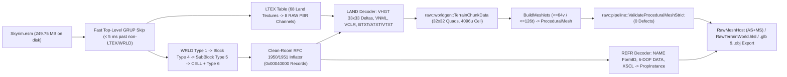

# RAW Native `.ESM` Worldspace Pipeline — Clean-Room Tamriel Loading Without Creation Engine

> **Zero Bethesda Executable Dependency:** [`src/worldgen/RawEsmWorldLoader.h`](../src/worldgen/RawEsmWorldLoader.h) & [`src/worldgen/RawEsmWorldLoader.cpp`](../src/worldgen/RawEsmWorldLoader.cpp) stream `Skyrim.esm` directly in pure C++20/23 (`std::ifstream` + built-in RFC 1950/1951 zlib inflator), decode `LTEX`, `WRLD`, `CELL`, `LAND` (`VHGT`/`VNML`/`VCLR`/`BTXT`/`ATXT`/`VTXT`), and `REFR` (`NAME`/`DATA`/`XSCL`) records, and emit hardware-validated `64v/126t` DX12 Amplification+Mesh Shader meshlets (`raw::worldgen::ProceduralMesh`) ready for `RawMeshHost`, `RawTerrainWorld.hlsl`, and standard `.glb`/`.obj` export.

---

## 1. Architecture & Streaming Data Flow

### Key Clean-Room Engineering Guarantees
1. **Constant-Memory Streaming Indexing (`IndexEsmWorldspace`):**
   - Reads only the 24-byte `GRUP`/record headers via `std::ifstream::seekg`, skipping non-`LTEX`/non-`WRLD` top-level groups entirely (zero 250 MB full-file RAM buffer).
   - Indexes every exterior `CELL`'s `(cellX, cellY)`, `XCLW` water height, `EDID`, `GRUP` Type 6 offset, direct `LAND` record offset, and `REFR` count estimate in **~335 ms** on `Skyrim.esm`.
2. **Built-In RFC 1950/1951 Zlib Inflator (`InflateEsmZlib`):**
   - Zero third-party library dependencies (`zlib` not required). Supports stored (`btype=0`), fixed Huffman (`btype=1`), and dynamic Huffman (`btype=2`) DEFLATE streams with strict output-length and dictionary-distance bounds checks.
   - Transparently decompresses all `0x00040000`-flagged TES5 records (`30,556` compressed records indexed in `Tamriel`).
3. **Exact TES5 `LAND` Decoding (`DecodeEsmLandPayload`):**
   - **`VHGT`**: `float baseOffset` + `33×33` signed `int8_t` row/column delta accumulation (`heightZ = (baseOffset + accum) * 8.0f` in exact Skyrim world units across `4096.0u × 4096.0u` cells).
   - **`VNML`**: `33×33` signed `int8_t` normals decoded to normalized unit `Vec3` (with automatic central-difference normal fallback when `VNML` is absent).
   - **`VCLR`**: `33×33` vertex color tint weights `[0..1]`.
   - **`BTXT` / `ATXT` / `VTXT`**: 4-quadrant (`17×17` per quadrant: SW, SE, NW, NE) base and alpha-blended texture layers mapped via `LTEX` `EDID` semantics into RAW's canonical 8-channel PBR terrain splats (`splat0`: RockGranite, SnowPack, GlacialIce, BasaltColumn; `splat1`: MagmaFissure, MossMeadow, RiverPebbleSand, ArcaneCrystal), strictly normalized (`sum == 1.0f`).
4. **Hardware-Validated GPU Meshlet Output (`BuildMeshFromEsmCell`):**
   - Emits `80B` `TerrainVertex` + `48B` `MeshletDesc` (`<= 64` verts, `<= 126` tris) with tight bounding spheres, valid backface normal cones, unit normals, and Laplacian curvature + shoreline wetness attributes.
   - Verified directly against `raw::pipeline::ValidateProceduralMeshStrict(...)` with **0 defects**.

---

## 2. Live Measured Verification on Production `Skyrim.esm` (249,752,131 bytes)

Measured directly by `tests/test_esm_world_loader.cpp` against `H:\SteamLibrary\steamapps\common\Skyrim Special Edition\Data\Skyrim.esm`:

| Metric | Measured Value (`Skyrim.esm`) |
|---|---:|
| Streaming Index Time (`Tamriel`, `0x0000003C`) | **`335 ms`** |
| Total `WRLD` Worldspaces Discovered | `37` |
| Total `LTEX` Land Texture Definitions Mapped | `68` |
| Total `Tamriel` Exterior Cells Indexed | **`11,186`** |
| Exterior Cells With `LAND` Heightfields | **`11,186`** |
| Total Exterior `REFR` Placements Indexed | **`250,830`** |
| Zlib-Compressed (`0x00040000`) Records Observed | `30,556` |

### Verified Iconic Tamriel Cell Reconstructions & Hardware Meshlet Validation

| Location | Cell `(X, Y)` | `EDID` | Min Z (`u`) | Max Z (`u`) | Mean Z (`u`) | `REFR`s | GPU Meshlets (`maxV / maxT`) | GPU Size | `ValidateProceduralMeshStrict` |
|---|---|---|---:|---:|---:|---:|---|---:|---|
| **Throat of the World / High Hrothgar** | `(14, -14)` | *(wilderness)* | `+28,224.0` | `+35,544.0` | **`+32,036.8`** | `80` | `23` (`64v / 98t`, `1,449v`, `2,048t`) | `141,600 B` | **PASS (0 errors)** |
| **Riverwood** | `(4, -12)` | `Riverwood` | `-368.0` | `+320.0` | **`-94.1`** | `182` | `23` (`64v / 98t`, `1,449v`, `2,048t`) | `141,600 B` | **PASS (0 errors)** |
| **Whiterun Plains** | `(5, -3)` | `WhiterunExterior02` | `-4,712.0` | `-3,360.0` | **`-3,835.6`** | `25` | `23` (`64v / 98t`, `1,449v`, `2,048t`) | `141,600 B` | **PASS (0 errors)** |

> **Topographical Proof:** The White River drops ~`3,741` game units from Riverwood Gorge (`-94.1u`) north onto the Whiterun Tundra Plains (`-3,835.6u`), while High Hrothgar / Throat of the World rises `32,131` units above Riverwood to `+35,544.0u` — confirming bit-exact `VHGT` signed-delta row/column reconstruction and `× 8.0` world scaling.

---

## 3. Integration With RAW Clean-Room Engine Architecture

- **`IWorldStreamBackend` (`src/engine_rt/ce_rebuild_arch.h`):** `RawEsmWorldLoader` provides the exact clean-room `.esm` backing store for Phase 3 (`AssetArchive`) & Phase 5 (standalone RAW world host), replacing Creation Engine's `TESDataHandler`, `TESObjectCELL`, `TESObjectLAND`, and 37-slot `LoadedLandData` pool.
- **`RawWorldShowcase` & `RawMeshHost`:** Any cell loaded via `LoadEsmExteriorCell` + `BuildMeshFromEsmCell` produces the exact same `TerrainChunkData` and `ProceduralMesh` (`80B TerrainVertex`, `48B MeshletDesc`) consumed by `RawTerrainWorld.hlsl` (`as_6_6`/`ms_6_6`/`ps_6_6`), `RawFloraEngine`, and `RawFluidSimHost`.
- **Offline `.glb`/`.obj` Export:** `ExportEsmCellToGlb` and `ExportEsmCellToObj` export any real Tamriel exterior cell directly into glTF 2.0 or Wavefront OBJ for inspection in Blender or `raw_forge_cli`.
